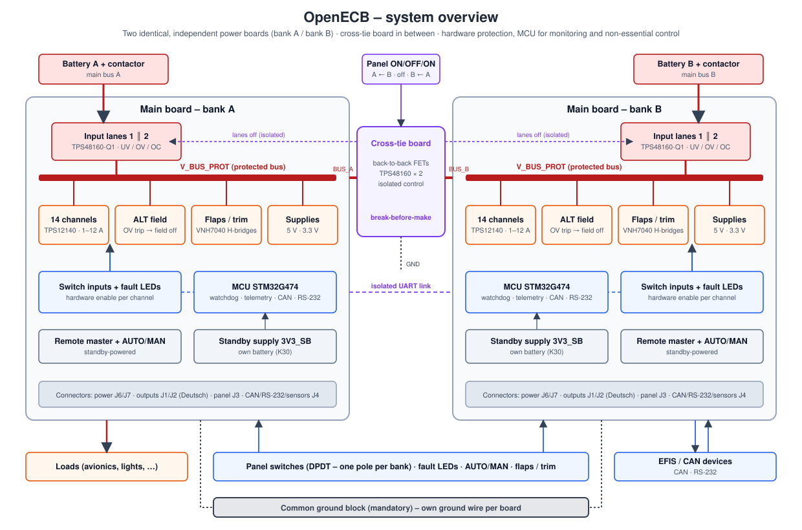

# OpenECB – Electronic Circuit Breaker for Experimental Aircraft

OpenECB is an electronic circuit breaker and power distribution unit for a 14 V experimental
aircraft (developed for a Van's RV-10). It replaces the classic panel of thermal breakers and
switches with protected electronic channels, while keeping the panel switches as the primary
means of control – conceptually similar to commercial units such as the VP-X or the AFS ACM.

> **Status: in development.** The design is not finished, not flight-tested and not certified.
> Do not install it in an aircraft. See the disclaimer at the end of this page.

---

## Design principles

- **Hardware protects, software assists.** Every protection and every switching path that a
  pilot relies on is implemented in hardware. The microcontroller observes, reports and may
  switch only non-essential loads. (Background: LBA guideline 240.9 treats software without
  manufacturer evidence as DAL E.)
- **No single point of failure.** Two identical, independent power boards (bank A and bank B),
  each with its own battery feed, ground wire and input stage. One failure must not take down
  both buses.
- **The panel switch always wins.** Essential channels work with the MCU missing, dead or
  unprogrammed. A dedicated AUTO/MAN switch removes every software override at once.
- **Simple, robust, hand-solderable.** Automotive-qualified parts (AEC-Q100/Q101/Q200) where
  possible, no BGA, no 0201, no programmable logic.

## Features (per board)

| Function | Description |
|---|---|
| Power input | Two hot-parallel input lanes (TPS48160-Q1 with back-to-back MOSFETs) from the main bus. Undervoltage and overvoltage disconnect (≈ 5.6 V / 24 V), reverse-polarity blocking, current and temperature monitoring. |
| Output channels | 14 protected high-side channels (TPS12140-Q1 + 100 V MOSFET). Current class 1–12 A set by shunt population. I²t overcurrent curve, short-circuit shutdown within ≈ 5 µs, latch-off, reset with the panel switch. |
| Essential / non-essential | Selectable per channel by solder jumper. Essential: controlled by the panel switch only (the MCU may switch it on, never off). Non-essential: may also be switched and reset by the MCU (e.g. load shedding, remote control from the EFIS). |
| Switch inputs | 16 panel switch inputs with filtering and bus-level protection; 14 control channels, one controls the alternator field, one is a "software switch" forwarded over CAN. |
| Status LEDs | Red fault LED per switch, driven directly by the protection hardware (lit as long as the channel is tripped). Green/yellow status via an LED board on CAN (on, or MCU and switch disagree). |
| Alternator field | Dedicated field channel with hardware overvoltage trip (> ≈ 16.9 V for ≈ 60 ms → field off and latched, reset with the ALT switch). |
| Flaps and trim | H-bridge outputs (VNH7040AY) for flaps and two trim axes. Flap selector (4 positions) plus UP/DN, position feedback via potentiometers. "Safety trim": hardware limits trim run time per button press; the MCU may slow down or stop the trim, never drive it. |
| Remote master | Switches the master contactor from the standby supply (e.g. for pre-heating). Two MOSFETs in series, one from the MCU and one from the AUTO/MAN line. |
| Cross-tie | Separate small board that connects bus A and bus B in an emergency. Selected by an ON/OFF/ON panel switch; the receiving side's input stage is always switched off first (break-before-make). Without switch or cable both sides run normally. Control signals are galvanically isolated. |
| Standby supply | Separate battery input keeps the MCU, CAN and the remote-master logic alive when the main bus is off. |
| MCU and interfaces | STM32G474, external watchdog, CAN (to EFIS, LED board, other devices), 2 × RS-232 (EFIS), isolated board-to-board link. Telemetry: current, voltage and temperature of every channel and lane. |

## How it works (overview)

1. **Input lanes.** Each board feeds its protected bus (V_BUS_PROT) through two parallel input
   lanes. A lane disconnects on under- or overvoltage and on overcurrent, independently of the MCU.
2. **Channels.** Each output channel is a self-contained electronic breaker: the controller
   measures the current through a shunt, integrates I² over time like a thermal breaker, and
   switches off instantly on a short circuit. A tripped channel stays off until the pilot cycles
   the switch.
3. **Switches and MCU.** The panel switch drives the channel enable directly. The MCU reads all
   switch states, fault flags and measurements through shift registers and an analog multiplexer.
   For non-essential channels it can override the switch; MAN mode or a failed MCU clears every
   override.
4. **Cross-tie.** If one bus loses its source, the pilot selects the direction on the cross-tie
   switch. The receiving board's input lanes are switched off and confirmed off via optocouplers
   before the tie closes, so the two batteries are never paralleled through the tie.
5. **Grounding.** Both boards and the cross-tie board have their own ground wire to a **common
   ground block** (mandatory; the cross-tie return current flows through it).

## Repository structure

| Folder | Content |
|---|---|
| `Schematics/` | KiCad schematics and PCB, exported PDFs |
| `Firmware/` | STM32 firmware (later) |
| `docs/` | Documentation and images |

Design documentation (specifications, interface control document, reviews) will be added as
the individual blocks are finished.

## License

OpenECB is **source-available**: you may study, build, modify and share it for **non-commercial**
purposes. Commercial use (selling boards, kits or devices) is reserved to the author.

- Hardware design and documentation (`Schematics/`, docs): **CC BY-NC-SA 4.0**
- Firmware (`Firmware/`): **PolyForm Noncommercial 1.0.0**

See [LICENSE.md](LICENSE.md) for details. For a commercial licence, please open an issue or
contact the author.

"OpenECB" and "BihnAiry" are names used by the author; they are not licensed for use on derived
products.

## Contributing

Ideas, reviews and bug reports are welcome – please use GitHub issues. Pull requests can only be
accepted together with a contributor licence agreement (CLA) that allows the author to use the
contribution in the commercial version as well. The CLA will be added to this repository.

## Disclaimer

This is an experimental design for amateur-built aircraft. It is **not certified**, **not
approved** for any aircraft and comes **without any warranty**. A failure of the power
distribution can lead to loss of electrical power in flight. Anyone who builds or installs it
does so at their own risk and is responsible for compliance with the applicable regulations.

© 2026 Patrick Bihn · BihnAiry
